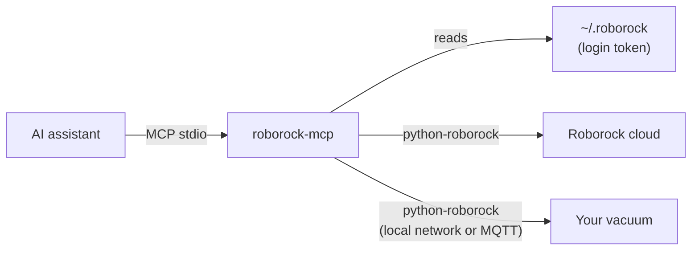

# roborock-mcp

MCP server for Roborock vacuums, built on [python-roborock](https://github.com/python-roborock/python-roborock).
Ask your AI assistant for the vacuum's status, a labelled map of your home, or to clean only the kitchen.

Unofficial project, not affiliated with Roborock.

<!-- mcp-name: io.github.anilsrml/roborock-mcp -->

## Tools

| Tool | What it does |
|---|---|
| `list_devices` | Devices on your account: name, `duid`, model, online |
| `get_status` | Live status of one device (battery, state, fan speed, errors) |
| `get_map` | Current home map as a PNG image, with each room's name written on it |
| `start_cleaning` | Clean the whole home, or only the given `rooms` (names from the Roborock app; unnamed rooms are `Room <number>`) |
| `pause_cleaning` | Pause the current cleaning |
| `return_to_dock` | Send the vacuum back to its charging dock |

Supported: vacuums that use Roborock's V1 protocol (S, Q5, Q7 Max series and similar).
Other models show up in `list_devices` but the other tools return "not supported yet".

## Setup

Needs [uv](https://docs.astral.sh/uv/) and git. uv downloads Python 3.12+ if you do not have it.

1. Log in once. Roborock sends a code to your email; type it in:

   ```bash
   uvx --from git+https://github.com/anilsrml/roborock-mcp roborock login --email you@example.com
   ```

   This writes your token to `~/.roborock`. Keep that file private (`chmod 600 ~/.roborock`).

2. Add the server to your MCP client.

   Claude Code:

   ```bash
   claude mcp add roborock -s user -- uvx --from git+https://github.com/anilsrml/roborock-mcp roborock-mcp
   ```

   Claude Desktop, Cursor and other clients (JSON config):

   ```json
   {
     "mcpServers": {
       "roborock": {
         "command": "uvx",
         "args": ["--from", "git+https://github.com/anilsrml/roborock-mcp", "roborock-mcp"]
       }
     }
   }
   ```

3. Restart your MCP client and ask in plain language:

   - "Is my vacuum charging? How much battery does it have?"
   - "Show me the map of my home."
   - "Clean only the kitchen and the living room."
   - "Pause the vacuum." / "Send it back to the dock."

## How it works



1. `roborock login` (from python-roborock) logs in with the email code and saves your token to `~/.roborock`.
   There is no password; the server only reads this token.
2. On the first tool call the server reads that file and asks the Roborock cloud for your home: devices, rooms, local keys.
   It saves this to `~/.roborock-mcp.cache`, because the cloud allows only 5 of these requests per hour.
3. Each tool call goes to the vacuum through python-roborock, which picks the connection itself:
   your local network when it can reach the vacuum, otherwise Roborock's MQTT cloud.
4. Rooms:
   - `get_map` draws the map as a PNG and writes each room's name on it, so you can see which names to use.
   - `start_cleaning` with `rooms` turns those names into the vacuum's room ids and starts a room cleaning.

## Development

```bash
git clone https://github.com/anilsrml/roborock-mcp.git
cd roborock-mcp
uv run pytest
```

## License

MIT
